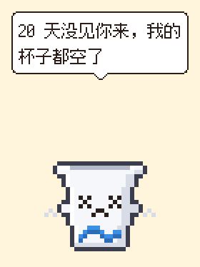

<div align="center">

# 麦旋宝 Flurrbit

**一杯住在你桌面上的像素麦旋风**


[](https://github.com/Shiroha17/mcd-flurrbit/actions/workflows/ci.yml)


[](LICENSE)

[快速开始](#快速开始) · [七种心情](#七种心情) · [成长](#成长) · [命令](#命令) · [安全](#安全)


</div>

好久没点麦当劳，杯口的冰淇淋会一天天塌下去，最后只剩一个空杯子。卡包里有券快过期，它急得直冒汗，冰淇淋也化了，顺着杯沿往下淌。刚下完单，它就眯起眼睛，在屏幕角落嚼个不停。积分攒得越多，冰淇淋堆得越高，慢慢染上草莓的粉色，到最后杯口镶上金边，头顶多了一顶小皇冠。

| 券快过期会提醒 | 积分到期前着急 | 有券没领、有活动会兴奋 |
|:---:|:---:|:---:|

这些变化都来自[麦当劳中国官方 MCP Server](https://github.com/M-China/mcd-mcp-server)的真实数据。

## 快速开始

**1. 下载**

到 [Release 页面](https://github.com/Shiroha17/mcd-flurrbit/releases)下载 `windows-amd64.zip`，解压运行即可。

**2. 先看看效果**

```powershell
.\flurrbit.exe --demo excited
```

**3. 接入自己的账户**

打开 <https://open.mcd.cn/mcp>，用手机号登录，激活 MCP Token 并复制。然后在 PowerShell 里保存 Token，重新打开终端后启动：

```powershell
[Environment]::SetEnvironmentVariable("MCD_MCP_TOKEN", "你的 MCP Token", "User")
.\flurrbit.exe
```

Token 会保存在环境变量里。

## 和旋宝互动

旋宝会出现在屏幕右下角，默认待在原地。启动时加上 `--walk`，或者运行时按 <kbd>W</kbd>，它就会在屏幕底下蹦着到处逛，只有睡觉和吃饭的时候待着不动。

| 操作 | 效果 |
|---|---|
| 左键单击 | 换一句话说 |
| 按住左键拖动 | 把它挪到别处 |
| 右键单击 | 看它的心情、饱腹、淡定和阶段 |
| <kbd>W</kbd> | 让它到处溜达，或者原地待着 |
| <kbd>Esc</kbd> 或 <kbd>Q</kbd> | 让它下班 |

## 七种心情

| | | | |
|:---:|:---:|:---:|:---:|
|  |  |  |  |
| **开心** | **兴奋** | **开饭中** | **有点饿** |
|  |  |  |  |
| **饿坏了** | **着急** | **犯困** | **至尊麦旋风** |

<details>
<summary><b>每种心情什么时候出现</b></summary>

<br />

| 心情 | 什么时候 | 看起来 |
|---|---|---|
| 着急 | 有券两天内到期，或者月底还有积分没用掉。要是哪张券连 24 小时都撑不到，半夜也会把它急醒 | 冒汗，举起双手，冰淇淋化开往下淌 |
| 开饭中 | 上一单下完还不到一个半小时 | 眯着眼嚼个不停，嘴边碎屑乱蹦 |
| 犯困 | 凌晨 0 点到 7 点 | 闭着眼，手垂下来，头顶飘出 Z |
| 饿坏了 | 十一天多没下单 | 冰淇淋吃光了，杯口露出空空的杯底，眼睛变成 × |
| 有点饿 | 一周没下单 | 冰淇淋只剩杯口薄薄一层，身边飘着咕咕的叫声 |
| 兴奋 | 麦麦省有券没领，或者今天有活动 | 蹦得更高，两只手轮流挥，身边一闪一闪 |
| 开心 | 什么事都没有 | 笑眯眯的，时不时眨眨眼 |

</details>

两个数值，右键点一下旋宝就能看到：

- **饱腹**：从上一单开始往下掉，十四天从 100 掉到 0。
- **淡定**：看快过期的券和积分，事情越急，数字越低。

## 成长

累计积分决定旋宝长到哪一步。

| 阶段 | 累计积分 | 样子 |
|---|---:|---|
| 🥤 迷你麦旋风 | 起步 | 白色纸杯印着一圈蓝色波浪，杯口堆着三团香草冰淇淋 |
| 🍦 经典麦旋风 | 2,000 | 中间那团冰淇淋堆得更高 |
| 🍓 草莓麦旋风 | 8,000 | 拌进草莓酱，冰淇淋变成淡粉色，点缀着几颗草莓粒 |
| 👑 至尊麦旋风 | 24,000 | 冰淇淋堆得最高，杯口和波浪换成金色，头顶戴着皇冠 |

## 命令

| 命令 | 作用 |
|---|---|
| `.\flurrbit.exe` | 把旋宝放到桌面上 |
| `.\flurrbit.exe status` | 在终端里用色块画出旋宝，旁边列出它的状态和想说的话 |
| `.\flurrbit.exe gif -o flurrbit.gif` | 把它此刻的样子连同一句台词存成动图，可以直接发进群里 |
| `.\flurrbit.exe doctor` | 依次检查 Token、握手和 6 个 Tool 是否可用 |
| `.\flurrbit.exe help` | 查看全部选项 |

| 选项 | 作用 |
|---|---|
| `--demo <场景>` | 用演示数据：`happy` `excited` `eating` `hungry` `starving` `anxious` `sleepy` `deluxe` |
| `--walk` | 启动时就让它到处溜达 |
| `--line <序号>` | 导出动图时换一句台词，从 0 数起 |
| `--refresh <时长>` | 多久同步一次账户，默认 `10m` |

## 实现

旋宝用 Go 编写，桌面窗口基于 [Ebitengine](https://ebitengine.org)。它的每一个像素都由代码画出来，项目里没有一张图片素材。麦当劳 MCP 的接入细节写在 [MCP_INTEGRATION.md](MCP_INTEGRATION.md)。

<details>
<summary><b>目录结构</b></summary>

```
cmd/flurrbit/        命令行入口：桌面、status、gif、doctor，以及 Windows 终端的颜色设置
cmd/logo/            用旋宝的样子生成 logo 和 exe 图标
internal/mcp/        Streamable HTTP 客户端，SSE 解码，Session 管理，只读白名单
internal/account/    并发调用 6 个 Tool，解析 JSON，另含演示数据
internal/pet/        根据账户快照算出心情、饱腹、淡定、成长阶段和台词
internal/sprite/     32×40 像素、放大 4 倍的麦旋风：四个成长阶段、七种表情、挥手、蹦跳、冒汗、融化、打呼、闪光和皇冠
internal/render/     像素气泡、中文换行与标点避头、GIF 编码、终端色块画
internal/desktop/    透明置顶窗口、蹦跶、拖动和点击
```

</details>

<details>
<summary><b>从源码编译</b></summary>

<br />

Go 1.23 或更新的版本。

```powershell
https://github.com/Shiroha17/mcd-flurrbit.git
cd mcd-flurrbit
go vet ./...
go build ./cmd/flurrbit
```

</details>

## 声明

字体用的是[缝合像素字体 Fusion Pixel Font](https://github.com/TakWolf/fusion-pixel-font)

旋宝说的话仅供参考，餐品、优惠券、活动和积分以麦当劳官方渠道的实时信息为准。

## License

[MIT](LICENSE)
